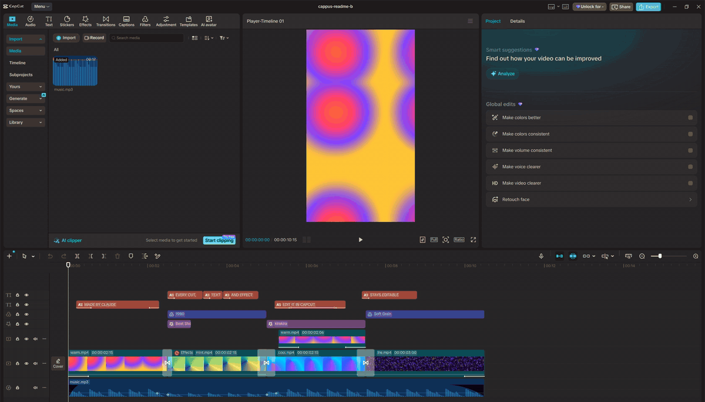
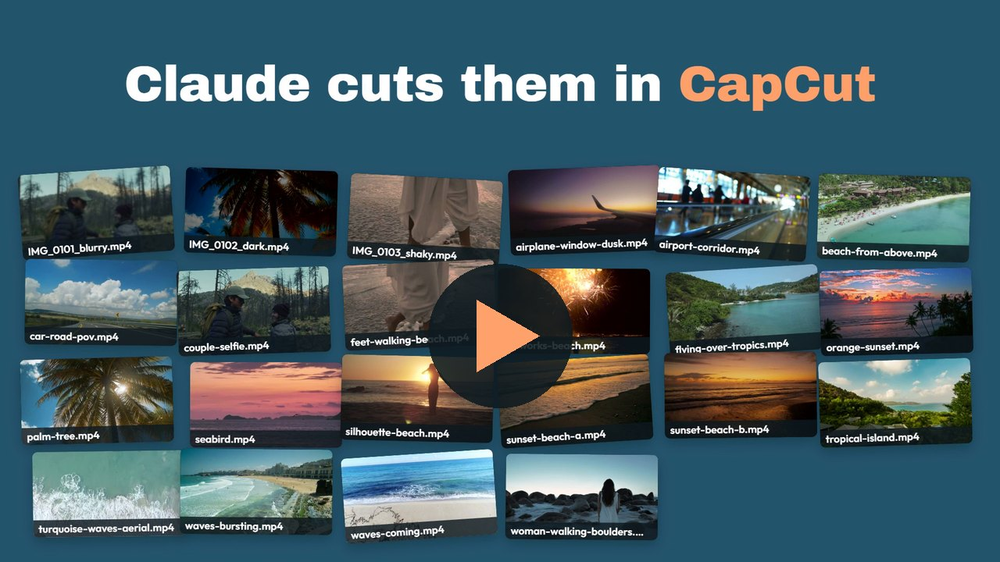

# cappus

**A Claude Code skill that edits your footage into a CapCut desktop project you can keep editing.**

Ask Claude for an edit in plain language. Instead of a flattened MP4, you get a normal CapCut draft:
every cut, text layer, transition, effect, filter, animation, keyframe and caption sits on the
CapCut timeline, ready for you to adjust and export.



*A draft cappus wrote, open in CapCut: four clips with transitions, titles, word-by-word captions,
effects, filters, a picture-in-picture and music. Every item on the timeline can still be edited.*

Works with **free CapCut and CapCut Pro**. You choose which one you have, and cappus only uses
resources your account can export.

Built for Claude Code, and usable from other AI coding agents that read Agent Skills (Codex, GitHub
Copilot, Cursor, Gemini CLI, Google Antigravity): see [Other AI agents](#other-ai-agents).

> Panduan berbahasa Indonesia: [docs/cara-pakai.md](docs/cara-pakai.md)

### Video tutorial

[](https://youtu.be/Jne3_vhNHUs)

*90 seconds on YouTube: one folder of 22 clips, from installing cappus to a finished, editable
CapCut reel.*

## What it can do

An AI video editor for CapCut desktop, driven by Claude Code. Ask in plain language, for example
"cut this into a 30-second TikTok with captions", and get a CapCut project, not a flat export.

- **Auto edit a pile of footage** into one video with a hook, body and payoff, synced to the music beat.
- **Auto captions** transcribed from the speech (offline, faster-whisper), word by word, with keyword highlight.
- **Talking-head edits**: jump cuts that remove silences, fillers and retakes, punch-ins, eased zoom-ins
  on key words, face tracking, and finding the best 20–60 s clips for Shorts in a long recording.
- **TikTok, Instagram Reels and YouTube Shorts formats**: 9:16 reframing that follows the moving subject.
- **Designed looks**: title and caption styles, fonts, motion presets, filters, effects and transitions
  from CapCut's own library (about 5,000 resources, free and Pro).
- **Eased keyframes** written as real CapCut ease curves, editable in CapCut's keyframe graph.
- **Audio**: generated royalty-free music and sound effects (whoosh, pop, hit, riser), loudness to −14 LUFS,
  noise reduction.
- **Preview** an approximate render with ffmpeg before you open CapCut.

## Contents

- [What it can do](#what-it-can-do)
- [How it works](#how-it-works)
- [Requirements](#requirements)
- [Installation](#installation)
- [Choose your plan: Free or Pro](#choose-your-plan-free-or-pro)
- [Usage](#usage)
  - [Captions](#captions)
- [Finishing in CapCut](#finishing-in-capcut)
- [Troubleshooting](#troubleshooting)
- [Running the scripts directly](#running-the-scripts-directly)
- [Updating](#updating)
- [Project structure](#project-structure)
- [Contributing](#contributing)
- [Acknowledgements and disclaimer](#acknowledgements-and-disclaimer)
- [License](#license)

## How it works

1. **Analyze.** Claude inspects your media: contact sheets of each clip, shot changes, pauses in
   speech, a word-by-word transcript of what is said, and the beats of your music.
2. **Plan.** It drafts the edit (hook, body, payoff) and writes it as an *edit spec*, a JSON file
   with times in seconds.
3. **Validate.** `build_draft.py` checks the spec against a catalog of real CapCut resources and
   reports every problem at once.
4. **Write.** The builder writes the draft straight into CapCut's drafts folder. Claude then tells
   you what it did, what it could not do, and what to check first.

Every transition, effect, filter, animation and font is referenced by CapCut's internal ID, taken
from a catalog of about 5,000 resources (about 1,200 free and 3,800 Pro). The builder rejects names
that are not in the catalog. It also rejects about 380 catalog items that CapCut has withdrawn, so
your draft never shows a missing effect or an "animation loss" label.

## Requirements

| Requirement | Notes |
|---|---|
| CapCut desktop (international edition) | Tested with CapCut 8.0.1 and 9.8.0 on Windows. macOS uses the same draft format but has not been tested yet. JianYing (the Chinese edition), CapCut mobile and CapCut web are not supported. |
| Claude Code, or another AI coding agent | Claude Code (the CLI, the Code tab of the Claude desktop app, or an IDE extension) is what cappus is tested with. Other agents that read Agent Skills also work, see [Other AI agents](#other-ai-agents). The agent must run **on the same computer as CapCut**, because drafts are written to CapCut's local drafts folder. Web chats (Claude.ai, ChatGPT, Gemini) and cloud sessions cannot do this. |
| Python 3.9 or later | Used by the bundled scripts. |
| ffmpeg and ffprobe | Must be on your `PATH`. Used to analyze media. |
| faster-whisper (optional) | Only for captions from speech. Runs offline; the first use downloads a speech model of about 0.5 GB. |

## Installation

### 1. Install the skill

**Option A: as a plugin (recommended).** Run these in your terminal:

```bash
claude plugin marketplace add nsudy-code/cappus
```

```bash
claude plugin install cappus@cappus
```

Or run the same steps inside a Claude Code session: `/plugin marketplace add nsudy-code/cappus`,
then `/plugin install cappus@cappus`, and choose a scope. A user-scope install is available in the
terminal, the desktop app and VS Code on the same computer.

**Option B: from a clone.** Use this if you want to contribute, or to update with `git pull`:

```bash
git clone https://github.com/nsudy-code/cappus.git
```

Then link the skill folder into Claude's skills directory. On Windows (PowerShell), from the folder
that contains the clone:

```powershell
New-Item -ItemType Junction -Path "$env:USERPROFILE\.claude\skills\capcut-editor" -Target "$PWD\cappus\skills\capcut-editor"
```

On macOS or Linux:

```bash
mkdir -p ~/.claude/skills && ln -s "$PWD/cappus/skills/capcut-editor" ~/.claude/skills/capcut-editor
```

Use one option, not both. With both, Claude sees the skill twice. (Copilot and Cursor also read
`~/.claude/skills`, so with them, skip the `~/.agents/skills` link below.)

### Other AI agents

cappus is a standard [Agent Skill](https://agentskills.io): a `SKILL.md` with instructions plus
plain Python scripts, nothing tied to Claude. Codex, GitHub Copilot (CLI and VS Code agent mode),
Cursor and Gemini CLI all read skills from `~/.agents/skills`, so one link serves them all.
Windows (PowerShell), from the folder that contains the clone:

```powershell
New-Item -ItemType Directory -Force "$env:USERPROFILE\.agents\skills" | Out-Null; New-Item -ItemType Junction -Path "$env:USERPROFILE\.agents\skills\capcut-editor" -Target "$PWD\cappus\skills\capcut-editor"
```

macOS or Linux:

```bash
mkdir -p ~/.agents/skills && ln -s "$PWD/cappus/skills/capcut-editor" ~/.agents/skills/capcut-editor
```

**Google Antigravity** keeps its global skills in `~/.gemini/config/skills` instead (older
versions: `~/.gemini/antigravity/skills`). Link the skill there too:

```powershell
New-Item -ItemType Directory -Force "$env:USERPROFILE\.gemini\config\skills" | Out-Null; New-Item -ItemType Junction -Path "$env:USERPROFILE\.gemini\config\skills\capcut-editor" -Target "$PWD\cappus\skills\capcut-editor"
```

```bash
mkdir -p ~/.gemini/config/skills && ln -s "$PWD/cappus/skills/capcut-editor" ~/.gemini/config/skills/capcut-editor
```

Each other tool also has its own folder (`~/.copilot/skills`, `~/.cursor/skills`, `~/.gemini/skills`)
if yours does not pick up `~/.agents/skills`. Restart the agent afterwards and ask it to list its
skills to check. An agent without skill support can still use cappus: open it in the clone and
ask it to read `skills/capcut-editor/SKILL.md` first ([AGENTS.md](AGENTS.md) tells it so).

What the agent needs:

- **A shell** to run Python and ffmpeg.
- **Image input**, to look at the contact sheets of your clips. Without it, cuts are chosen from the
  transcript and pauses only, and are rougher.
- **A strong model.** The builder rejects an invalid spec, so a weak model cannot break your CapCut,
  but the quality of the edit (hook, pacing, look) depends on the model.

Only Claude Code is tested so far. Reports from other agents are welcome as issues.

### 2. Install the Python dependencies

```bash
python -m pip install "pycapcut==0.0.4" numpy Pillow
```

On macOS and most Linux systems the command is `python3` (`python3 -m pip install ...`), here and in
every command below. From a clone you can run
`python -m pip install -r skills/capcut-editor/requirements.txt` instead.
`pycapcut` writes the draft files, `numpy` is used for beat detection, and `Pillow` draws the preview render. If they are missing,
Claude installs them on first use. To check a machine, run
`python skills/capcut-editor/scripts/doctor.py`: it checks Python, these packages, ffmpeg, CapCut
desktop and its drafts folder, and says how to fix anything missing. It needs nothing installed,
and Claude runs it at the start of every session.

**Optional: captions from speech.**

```bash
python -m pip install faster-whisper
```

This adds offline speech-to-text (Whisper). It is only needed for captions and transcript-based
cutting. If it is missing when you ask for captions, Claude offers to install it. The first
transcription downloads the default `small` model (about 0.5 GB); after that no network is needed.

### 3. Check the installation

Start a **new** Claude Code session (skills load when a session starts) and ask:
"Is the capcut-editor skill available?" With the plugin install, the skill also appears as
`/cappus:capcut-editor` when you type `/`.

## Choose your plan: Free or Pro

CapCut offers free resources and Pro (paid) resources. A draft that uses Pro items opens and
previews in any account, but only a CapCut Pro account can export it. cappus therefore needs to
know which plan you have.

| | Free (default) | Pro |
|---|---|---|
| Resources available | About 1,200 free items | The full catalog, about 5,000 items |
| Curated picks with English names | About 490 | About 490, plus about 390 Pro picks: film looks, camera-move effects, light leaks, refined text animations and fonts |
| Background removal in the draft | No | Yes (CapCut's Auto removal) |
| Export | Always works | The exporting account needs CapCut Pro |

**How to choose:**

- **Answer once.** On first use, Claude asks whether you have CapCut Pro and remembers your answer.
  Until you answer, it uses free resources only.
- **Tell Claude at any time.** Say "I use the free version of CapCut" or "I have CapCut Pro".
  Claude saves the setting and uses it from then on.
- **Set it yourself.** From a clone, run `python skills/capcut-editor/scripts/tier.py free` or
  `... tier.py pro`. Run `tier.py` with no argument to see the current setting.

The setting is stored per user in `~/.cappus/config.json`. The environment variable
`CAPPUS_TIER=free` or `CAPPUS_TIER=pro` overrides it, which is useful on shared machines.

**One draft for a free account.** If you have Pro but a draft will be exported by someone on free
CapCut, say so ("this one will be exported from a free account"). Claude builds that draft with
free resources only.

## Usage

Ask Claude in plain language. Name the files or folder, where the video is going, the rough
length and the style. Claude fills in sensible defaults (vertical 1080x1920 at 30 fps for
short-form) and states its assumptions instead of asking a list of questions.

Example requests:

> Edit the clips in D:\Trips\Bali into a 20-second vertical reel synced to song.mp3. Cinematic
> look, with a title at the start.

> Cut the dead air and the repeated takes out of interview.mp4, add word-by-word captions, and keep
> it under 60 seconds for YouTube Shorts.

> Make a 15-second product ad from the photos and clips in D:\Products\Coffee. Hook in the first
> two seconds, a short label for each feature, and end on logo.png.

> Turn the photos in D:\Wedding into a 45-second slideshow with gentle motion on every photo,
> timed to music.mp3.

### Opening the result

Open CapCut. The draft appears in your project list under the name Claude reports. If CapCut was
already open, go back to the home screen or restart CapCut so it rescans its drafts.

Media is **linked, not copied**. Do not move, rename or delete the source files, or CapCut will
show them as offline.

### Great results from a one-line request

You do not have to describe the edit. cappus decides the structure, the look, the music and every
timing so the first draft already looks designed:

- **"Make a promo for my website lux.ai.id"**: Claude reads the site, keeps only what it says, and
  makes a kinetic-typography promo (huge words on every beat) or a version with phone screenshots
  of the site.
- **"Turn these photos into a reel"**: cuts on the beat, motion on every photo, a few strong lines.
- **"Make these clips into one video"**: Claude sorts a whole folder like an editor (sharp, steady,
  well-lit shots first, duplicates and bad takes out), picks the best seconds of each, tells the story
  in the right order, matches the colors, and reframes horizontal footage around the action (the
  vertical crop follows a subject that walks, flies or drives across the frame).
- **Looks**: nine tested styles (`kinetic`, `bold_promo`, `clean_tech`, `cinematic`, `playful`,
  `luxury`, `street`, and `edu` and `talk` for people talking to camera), each a font pairing, colors, text animation and music mood. Your brand color
  is used automatically.
- **Fonts**: 50 free CapCut fonts picked by looking at all of them, sized to fill the frame.
- **Music**: no track? cappus generates one that is free to use, on an exact beat grid, so every cut
  and word lands on the beat. Swap in a CapCut library song with the same BPM later if you like.
- **Sound effects**: generated whooshes, pops, ticks, hits and risers, free to use, each landing on
  the frame its cut or title appears, a little louder than the music. Repeats use different takes.
- **Checked before you see it**: with computer use on, Claude opens the draft in CapCut and looks
  at it before handing it over. Without it, Claude renders a rough low-res preview with ffmpeg
  (`preview.py`) and checks the cut, framing and text placement on its contact sheet. That preview
  leaves out CapCut's effects, filters, transitions and fonts, so it only stands in for a look at the
  timing and layout.

### Captions

For footage with speech, Claude transcribes it offline and writes the captions into the draft as
ordinary CapCut text, styled and editable. Each word keeps its time in the source file, so the
captions stay in sync after Claude removes pauses, drops repeated takes or reorders sentences. Captions can light up the word being said and show a keyword per sentence in color and bigger. For
someone talking to camera, Claude cuts the pauses, "um"s and flubbed takes from the transcript and
the silences (`cut_talk.py`), alternates the framing at the cuts, suggests the strongest line to open
on, and marks where B-roll fits. With the optional OpenCV package it also finds the face, so a
horizontal recording is cropped to vertical around the speaker, punch-ins stay on the face and
captions don't cover it. Tell
Claude how to spell names, brands and unusual terms. If a word is wrong, fix it in CapCut or ask
Claude to transcribe again with the more accurate `large-v3-turbo` model (about 1.6 GB, slower).
If you already have an SRT file, give it to Claude instead.

### Revisions

Ask for changes in the same way: "make the title smaller", "swap the second and third clips",
"less saturated". Claude edits the spec and rebuilds the draft.

- Claude only overwrites drafts that cappus created. Your other CapCut projects are never touched.
- Each build records a fingerprint of the timeline. If you changed the draft in CapCut since then
  (opening and playing it does not count; audio settings such as Reduce noise or beat markers do),
  the rebuild stops and Claude asks you first: keep both under different names, or replace yours.
- A replaced version is never deleted. It moves to `~/.cappus/backups/<name>-<time>`; the newest 5
  per draft are kept. To restore one, close it in CapCut, move the current draft folder out, and
  move the backup into CapCut's drafts folder under the original name.
- Close the draft in CapCut (return to the home screen) before a rebuild. If another program has a
  file in the draft open (OneDrive, an antivirus scan), the rebuild stops without changing
  anything; try again a minute later.

## Finishing in CapCut

Some features cannot be written into a draft. Each takes one or two clicks in CapCut:

| You want | In CapCut |
|---|---|
| Speed ramp (curve speed) | Select the clip > Speed > Curve |
| Auto captions without installing faster-whisper | Text > Auto captions (with faster-whisper, Claude adds the captions itself; see [Captions](#captions)) |
| Remove the background by brush | Select the clip > Video > Remove BG > Custom removal (with Pro, Claude can turn on Auto removal in the draft itself) |
| Color wheels, HSL, curves, LUTs | Select the clip > Adjust |
| CapCut's own sound-effect and music library (cappus makes its own whoosh, pop, tick, hit and riser) | Audio > Sound effects / Music |
| Export | Export button, top right |

## Troubleshooting

| Symptom | Cause and fix |
|---|---|
| The draft is not in the project list | CapCut was open during the build. Return to the home screen or restart CapCut. If you changed CapCut's drafts location, tell Claude where it is. |
| "Animation loss", a missing effect icon, or a font that falls back to the default | CapCut no longer serves that resource. Open the draft once, return to the home screen, and tell Claude. It runs `check_resources.py read`, replaces the items, rebuilds, and records them so they are not used again. Please [report it](https://github.com/nsudy-code/cappus/issues/new/choose) so everyone gets the fix. |
| An effect shows a download spinner | CapCut downloads each resource the first time it is used. Stay online and wait. |
| "Media offline" | The source files were moved or renamed. Relink them in CapCut, or tell Claude the new location. |
| Clicking a rebuilt draft does nothing | CapCut stayed open while cappus 0.5.1 or older rebuilt a draft CapCut had already opened. Restart CapCut. Current versions avoid this. |
| The draft opens with an empty timeline | Your CapCut version may store drafts differently. Please [open a bug report](https://github.com/nsudy-code/cappus/issues/new/choose) with your CapCut version (Settings > About). |
| Pro items in a draft you cannot export | Your plan is set to Pro, or the draft was built for Pro. Tell Claude "I use the free version of CapCut" and ask it to rebuild the draft. |

## Running the scripts directly

Claude runs these for you, but you can also use them yourself from a clone. Every script prints
JSON and has `--help`.

| Script | Purpose |
|---|---|
| `probe.py` | Media info, contact sheets, shot changes, speech segments, music beats |
| `transcribe.py` | Speech to text with a time for every word, plus an optional SRT (needs faster-whisper) |
| `cut_talk.py` | Turn a talking-head take into a jump-cut spec: pauses, fillers and retakes out, punch-ins, hook ranking, B-roll slots |
| `catalog.py` | Search the CapCut resources: transitions, effects, filters, animations, fonts |
| `build_draft.py` | Validate a spec (`--check`) and write it as a CapCut draft |
| `inspect_draft.py` | Read an existing draft, including your manual edits in CapCut |
| `preview.py` | Render an approximate low-res MP4 and a contact sheet of a spec with ffmpeg, without CapCut |
| `tier.py` | Show or set your CapCut plan (free or Pro) |
| `doctor.py` | Check the setup: Python, packages, ffmpeg, CapCut desktop and its drafts folder |
| `looks.py` | List the looks (font pairing, colors, motion, music) or show one |
| `music.py` | Generate a free music bed with an exact beat map |
| `sfx.py` | Generate the free sound-effect kit (whoosh, pop, tick, hit, riser) with each peak time |
| `faces.py` | Find the speaker's face (optional OpenCV): crop to vertical around it, punch-ins, text spots off it |
| `presets.py` | Save a series' look, colors, captions, speaker, handle and logo once; use it for every episode |
| `shorts.py` | Find the best 20-60 s clips in a long recording and cut each into its own spec |
| `scan_footage.py` | Sort a folder of footage: shots, quality scores, duplicates, best windows, color matching, reframing |
| `site_capture.py` | Screenshot a website on a phone and extract its text, prices, contacts and colors (needs Playwright) |
| `check_resources.py` | Find catalog items CapCut can no longer load |

Try the bundled demo:

```bash
python examples/make_test_media.py
```

```bash
python skills/capcut-editor/scripts/build_draft.py examples/demo.json --check
```

```bash
python skills/capcut-editor/scripts/build_draft.py examples/demo.json --overwrite
```

```bash
python skills/capcut-editor/scripts/preview.py examples/demo.json --out demo-preview
```

The last command writes `demo-preview/preview.mp4` (540x960, 15 fps) and `demo-preview/sheet.jpg`.
It is an approximation stamped "PREVIEW - approximate": clips, framing, motion, text positions and
audio follow the spec, and texts use CapCut's own font files when CapCut has downloaded them. Effects,
filters, transitions, animations and masks are not drawn.

Then open the `cappus-demo` draft in CapCut. `examples/demo-pro.json` shows Pro resources and needs
`--allow-pro` or a Pro setting. `examples/demo-sfx.json` adds generated sound effects: whooshes on the
transitions, pops on the titles, a riser into a hit on the end card.

## Updating

- **Plugin install:** run `claude plugin update cappus@cappus`, or open `/plugin` in a session, go
  to the **Installed** tab, select cappus and choose **Update now**. Plugins from this marketplace
  do not update automatically unless you turn on auto-update for it on the **Marketplaces** tab.
- **Clone install:** run `git pull` in the clone.

Updates also bring the latest list of resources CapCut has withdrawn, so update when you see
"animation loss". Start a new Claude Code session after updating.

## Project structure

```
skills/capcut-editor/
  SKILL.md                  Instructions Claude follows
  references/
    edit-spec.md            Edit spec format (JSON)
    editing-craft.md        Pacing, genre recipes, effect palettes by mood (free and Pro)
    capcut-notes.md         Limits, CapCut follow-ups, troubleshooting
  scripts/
    probe.py                Media analysis
    transcribe.py           Speech to text with word timings (optional)
    cut_talk.py             Talking head to jump cuts, hooks and B-roll slots
    faces.py                Face finder for framing talking heads (optional OpenCV)
    presets.py              Series presets (~/.cappus/presets)
    shorts.py               Long recording to several shorts
    catalog.py              Resource search
    build_draft.py          Spec to CapCut draft
    inspect_draft.py        Read existing drafts
    preview.py              Approximate ffmpeg preview and contact sheet of a spec
    tier.py                 Free or Pro setting
    doctor.py               Setup check
    looks.py, looks.json    Tested looks
    fonts.json              50 curated free fonts with roles, moods and widths
    motion.py               Eased enter/exit presets (pop, slam, whip, zoom_through, ...)
    music.py                Generated music with a beat map
    sfx.py                  Generated sound effects with their peak times
    site_capture.py         Website capture for promos
    check_resources.py      Detect resources CapCut no longer loads
    aliases.json            ~490 curated free resources with English aliases
    aliases_pro.json        ~390 curated Pro resources with English aliases
    unavailable.json        Resources CapCut has withdrawn; the builder rejects them
  requirements.txt
  requirements-captions.txt Optional speech-to-text dependency
  requirements-faces.txt    Optional face detection (OpenCV 4) for talking heads
docs/cara-pakai.md          User guide in Indonesian
docs/demo.gif               The animation at the top of this README
docs/video-tutorial.jpg     Thumbnail for the video tutorial link
examples/                   Demo specs and a synthetic media generator
.claude-plugin/             Plugin and marketplace manifests
```

## Contributing

Contributions are welcome, especially reports of resources that no longer load in your CapCut
version. Read [CONTRIBUTING.md](CONTRIBUTING.md) before you open a pull request.

## Acknowledgements and disclaimer

Drafts are written with [pycapcut](https://github.com/GuanYixuan/pyCapCut), which is also the source
of the CapCut resource catalog.

cappus is an independent project. It is not affiliated with, endorsed by or sponsored by CapCut or
ByteDance. CapCut is a trademark of its respective owner. CapCut Pro resources require a valid
CapCut Pro subscription to export.

## License

[MIT](LICENSE)
