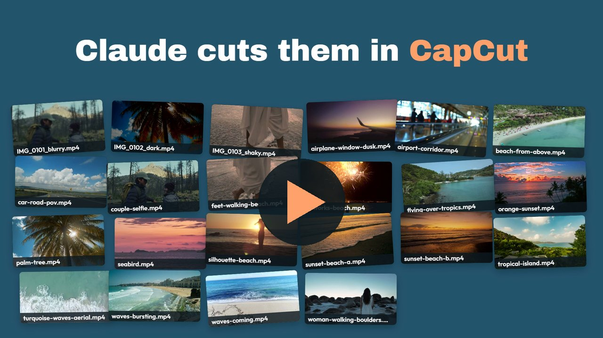

# Cara pakai cappus

Panduan ini untuk orang yang mau memakai skill `capcut-editor`: memasang, meminta edit ke Claude,
membuka hasilnya di CapCut, dan merevisi. Detail teknis format spec ada di
[`edit-spec.md`](../skills/capcut-editor/references/edit-spec.md).

**Video tutorial (90 detik, bahasa Inggris):** satu folder berisi 22 klip, dari memasang cappus
sampai jadi reel yang masih bisa diedit di CapCut.

[](https://youtu.be/Jne3_vhNHUs)

## Isi

1. [Cara kerjanya](#1-cara-kerjanya)
2. [Persiapan (sekali per komputer)](#2-persiapan-sekali-per-komputer)
3. [Meminta edit pertama](#3-meminta-edit-pertama)
4. [Apa yang dikerjakan Claude](#4-apa-yang-dikerjakan-claude)
5. [Membuka hasil di CapCut](#5-membuka-hasil-di-capcut)
6. [Revisi](#6-revisi)
7. [Yang harus dikerjakan di CapCut](#7-yang-harus-dikerjakan-di-capcut)
8. [CapCut Pro](#8-capcut-pro)
9. [Tips agar hasilnya bagus](#9-tips-agar-hasilnya-bagus)
10. [Masalah umum](#10-masalah-umum)
11. [Menjalankan skrip sendiri](#11-menjalankan-skrip-sendiri)
12. [Memperbarui skill](#12-memperbarui-skill)

## 1. Cara kerjanya

Anda memberi Claude bahan (video, foto, lagu) dan arahan. Claude menganalisis bahannya, menyusun
rencana edit, lalu menulis **draft proyek CapCut** langsung ke folder proyek CapCut di komputer Anda.

Hasilnya bukan file MP4. Anda membuka CapCut dan proyek itu sudah ada di daftar proyek, lengkap
dengan potongan klip, teks, transisi, efek, filter, animasi, keyframe, dan caption. Semuanya bisa
diubah seperti proyek yang Anda buat sendiri. Ekspor tetap Anda lakukan dari CapCut.

Semua efek yang dipakai adalah efek asli CapCut. Pengguna CapCut gratis hanya mendapat efek gratis,
jadi proyeknya selalu bisa diekspor. Pengguna CapCut Pro mendapat seluruh katalog, termasuk pilihan
efek Pro (lihat [bagian 8](#8-capcut-pro)).

## 2. Persiapan (sekali per komputer)

### Kebutuhan

- **CapCut desktop** versi internasional. Sudah dicoba di CapCut 8.0.1 dan 9.8.0 (Windows). macOS
  memakai format draft yang sama tetapi belum dicoba. JianYing (versi Tiongkok), CapCut di HP, dan
  CapCut web tidak didukung.
- **Python 3.9 atau lebih baru.**
- **ffmpeg dan ffprobe** yang bisa dipanggil dari terminal.
- **AI agent yang berjalan di komputer yang sama dengan CapCut**, misalnya Claude Code atau tab Code
  di aplikasi Claude desktop. Agent lain seperti Codex, GitHub Copilot, Cursor, Gemini CLI dan Google Antigravity juga
  bisa (lihat [Memakai agent selain Claude](#memakai-agent-selain-claude)). Chat di browser (Claude.ai,
  ChatGPT, Gemini) tidak bisa menulis ke folder CapCut Anda.

### Langkah 1: install dependensi Python

```bash
python -m pip install "pycapcut==0.0.4" numpy Pillow
```

Perintah ini memasang `pycapcut` (penulis draft CapCut), `numpy` (analisis beat lagu) dan `Pillow` (preview render). Kalau
belum terpasang, Claude juga akan memasangnya saat pertama kali dipakai. Di macOS dan kebanyakan
Linux, perintahnya `python3` (`python3 -m pip install ...`), juga untuk semua perintah di panduan ini.

**Opsional, untuk caption otomatis dari suara:**

```bash
python -m pip install faster-whisper
```

Ini memasang Whisper versi offline untuk mengubah suara jadi teks. Pertama kali dipakai, ia
mengunduh model sekitar 0,5 GB; setelah itu berjalan tanpa internet. Tidak wajib: kalau belum
terpasang, Claude akan menawarkan memasangnya saat Anda pertama kali minta caption.

### Langkah 2: pasang skill ke Claude

Pilih salah satu cara saja. Kalau dua-duanya dipakai, skill-nya terbaca dua kali.

**Cara A: sebagai plugin (disarankan).** Jalankan di terminal:

```bash
claude plugin marketplace add nsudy-code/cappus
```

```bash
claude plugin install cappus@cappus
```

Bisa juga dari dalam sesi Claude Code: `/plugin marketplace add nsudy-code/cappus`, lalu
`/plugin install cappus@cappus` dan pilih scope. Plugin yang dipasang untuk user berlaku di
terminal, aplikasi desktop, dan VS Code di komputer yang sama.

**Cara B: clone repo lalu buat junction/symlink.** Cocok kalau Anda ingin ikut mengembangkan, atau
ingin memperbarui dengan `git pull`. Claude membaca skill langsung dari folder repo.

```bash
git clone https://github.com/nsudy-code/cappus.git
```

Windows (PowerShell), ganti `<repo>` dengan lokasi folder repo:

```powershell
New-Item -ItemType Junction -Path "$env:USERPROFILE\.claude\skills\capcut-editor" -Target "<repo>\skills\capcut-editor"
```

macOS:

```bash
ln -s "<repo>/skills/capcut-editor" ~/.claude/skills/capcut-editor
```

Setelah memakai cara ini, jangan pindahkan atau hapus folder repo.

#### Memakai agent selain Claude

cappus adalah [Agent Skill](https://agentskills.io) standar: `SKILL.md` berisi instruksi plus skrip
Python biasa, tidak terikat ke Claude. Codex, GitHub Copilot (CLI dan agent mode di VS Code), Cursor
dan Gemini CLI sama-sama membaca skill dari folder `~/.agents/skills`. Clone repo seperti Cara B,
lalu buat link ke folder itu.

Windows (PowerShell), ganti `<repo>` dengan lokasi folder repo:

```powershell
New-Item -ItemType Directory -Force "$env:USERPROFILE\.agents\skills" | Out-Null; New-Item -ItemType Junction -Path "$env:USERPROFILE\.agents\skills\capcut-editor" -Target "<repo>\skills\capcut-editor"
```

macOS atau Linux:

```bash
mkdir -p ~/.agents/skills && ln -s "<repo>/skills/capcut-editor" ~/.agents/skills/capcut-editor
```

**Google Antigravity** menyimpan skill global di `~/.gemini/config/skills` (versi lama:
`~/.gemini/antigravity/skills`), jadi buat link ke sana juga:

```powershell
New-Item -ItemType Directory -Force "$env:USERPROFILE\.gemini\config\skills" | Out-Null; New-Item -ItemType Junction -Path "$env:USERPROFILE\.gemini\config\skills\capcut-editor" -Target "<repo>\skills\capcut-editor"
```

```bash
mkdir -p ~/.gemini/config/skills && ln -s "<repo>/skills/capcut-editor" ~/.gemini/config/skills/capcut-editor
```

Kalau agent lain tidak membaca `~/.agents/skills`, pakai folder khususnya: `~/.copilot/skills`,
`~/.cursor/skills` atau `~/.gemini/skills`. Copilot dan Cursor juga membaca `~/.claude/skills`, jadi
kalau sudah memakai Cara B, link ini tidak perlu. Agent yang belum mendukung skill tetap bisa: buka
agent di folder repo dan minta dia membaca `skills/capcut-editor/SKILL.md` dulu (file `AGENTS.md`
di repo sudah menyuruhnya).

Agent-nya perlu bisa menjalankan perintah shell, bisa melihat gambar (untuk contact sheet klip), dan
memakai model yang cukup kuat. Sejauh ini yang sudah diuji baru Claude Code.

### Langkah 3: cek

Buka sesi Claude **baru** (skill dibaca saat sesi dimulai), lalu tanya: "skill capcut-editor sudah
terpasang?". Claude bisa melihat daftar skill yang aktif. Kalau dipasang sebagai plugin, skill ini
juga muncul sebagai `/cappus:capcut-editor` saat Anda mengetik `/`.

Untuk mengecek isi komputernya, jalankan dari folder repo:

```bash
python skills/capcut-editor/scripts/doctor.py
```

Skrip ini mengecek Python, paket di atas, ffmpeg, CapCut desktop, dan folder draft-nya, lalu
menyebut cara memperbaiki yang kurang. Skrip ini tidak butuh paket apa pun, jadi bisa dijalankan
sebelum langkah 1. Claude juga menjalankannya di awal setiap sesi. Kalau CapCut desktop tidak
ada, Claude memberi tahu dulu dan menawarkan dua pilihan: pasang CapCut (gratis, Windows atau
macOS), atau minta video jadi (MP4) yang dirender dengan ffmpeg.

### Langkah 4: pilih CapCut gratis atau Pro

Bilang saja ke Claude, misalnya "Saya pakai CapCut gratis" atau "Saya punya CapCut Pro". Kalau
tidak, Claude akan bertanya sekali saat pertama kali dipakai. Selama belum dijawab, Claude hanya
memakai efek gratis. Detailnya ada di [bagian 8](#8-capcut-pro).

## 3. Meminta edit pertama

### Siapkan bahan

Kumpulkan video, foto, dan lagu dalam satu folder. Draft CapCut hanya **menautkan** file, tidak
menyalinnya. Kalau file dipindah atau diganti namanya setelah draft dibuat, CapCut akan menampilkan
"media offline".

Musik harus berupa file milik Anda (MP3, WAV, dan sebagainya). Claude tidak bisa mengambil lagu dari
library musik CapCut. Lagu dari library bisa Anda tambahkan sendiri di CapCut setelahnya.

Sound effect tidak perlu disiapkan. Claude membuat sendiri whoosh (untuk transisi), pop (teks
muncul), tick, hit (hentakan) dan riser, gratis dipakai di mana saja. Setiap suara jatuh tepat di
frame transisi atau teksnya, sedikit lebih keras dari musik, dan ada di track `sfx` sehingga mudah
digeser, diganti atau dihapus di CapCut. Minta "tanpa sound effect" kalau tidak mau, atau beri file
Anda sendiri.

### Tulis permintaan

Tulis seperti memberi arahan ke editor manusia. Yang paling membantu:

| Sebutkan | Kalau tidak disebut |
|---|---|
| Lokasi file atau folder bahan | Claude akan menanyakannya |
| Tujuan (Reels, TikTok, Shorts, YouTube) atau rasio | Vertikal 9:16, 1080x1920, 30 fps |
| Perkiraan durasi | 15-40 detik untuk konten pendek |
| Gaya atau mood (energik, sinematik, hangat, lucu, rapi) | Claude menebak dari isi footage dan menyebut tebakannya |
| Lagu dan bagian yang dipakai ("mulai dari reff") | Tanpa musik tambahan; Claude memilih bagian lagu yang paling kuat kalau Anda memberi lagu |
| Teks yang wajib muncul (judul, nama, ajakan) | Claude menambahkan teks seperlunya |
| Momen penting ("lompatan di detik 12 klip ketiga") | Claude memilih sendiri dari contact sheet |
| Punya CapCut Pro atau tidak | Claude bertanya sekali lalu mengingatnya (lihat [bagian 8](#8-capcut-pro)) |

Anda tidak perlu menyebut nama efek. Cukup sebut suasananya, Claude yang memilih efek CapCut yang
cocok. Kalau Anda punya efek favorit di CapCut, sebut namanya; Claude akan mencarinya di katalog.

### Contoh permintaan

**Montase ikut beat (travel, acara, olahraga)**

> Bikin reels 9:16 sekitar 20 detik dari video di D:\Liburan\Bali, ikut beat lagu
> D:\Musik\summer.mp3 mulai dari bagian reff. Gayanya energik, judul "BALI 2026" di awal.

**Talking head (review, tutorial, potongan podcast)**

> Rapikan video D:\Konten\review-hp.mp4: buang jeda diam dan kalimat yang diulang, kasih zoom
> bergantian di tiap potongan, dan caption kata per kata dari suaranya. Format 9:16.

**Vlog sinematik**

> Edit klip di folder D:\Vlog\Bromo jadi video 16:9 sekitar 60 detik. Nuansanya tenang dan
> sinematik, musik D:\Musik\ambient.mp3, transisi halus, judul kecil di awal.

**Promo produk**

> Buat iklan 15 detik untuk kopi kami dari foto dan video di D:\Produk\Kopi. Dua detik pertama harus
> langsung menarik, tiap keunggulan diberi label teks pendek, tutup dengan logo D:\Produk\logo.png dan
> tulisan "Pesan sekarang".

**Slideshow foto**

> Bikin slideshow kenangan dari foto-foto di D:\Foto\Wisuda. Tiap foto bergerak pelan, musik
> D:\Musik\piano.mp3, nuansa hangat, tanggal dan tempat muncul di awal.

## 4. Apa yang dikerjakan Claude

1. **Memeriksa bahan:** ukuran, durasi, fps, dan orientasi tiap file.
2. **Melihat isi video** lewat contact sheet (kumpulan cuplikan gambar) supaya potongan jatuh di
   momen yang tepat, bukan di tengah gerakan.
3. **Menganalisis audio:** beat dan bagian paling bertenaga dari lagu, atau jeda diam pada video
   orang bicara.
4. **Mentranskrip ucapan** pada video orang bicara, lengkap dengan waktu tiap kata. Claude memakainya
   untuk memotong di antara kalimat, membuang kalimat yang diulang, dan membuat caption.
5. **Menyusun rencana:** pembuka (hook), isi, dan penutup, lengkap dengan waktu.
6. **Menulis spec**, yaitu file JSON berisi resep edit. File ini disimpan di dekat bahan Anda dan
   menjadi bahan revisi nanti.
7. **Memvalidasi spec:** semua nama efek dicocokkan dengan katalog CapCut, dan durasi serta posisi
   teks diperiksa.
8. **Menulis draft** ke folder proyek CapCut.
9. **Melapor:** nama draft, alasan di balik edit, bagian yang perlu Anda cek, dan hal yang perlu
   diselesaikan di CapCut.

Kalau computer use aktif, Claude membuka draft di CapCut dan melihatnya sendiri. Kalau tidak,
Claude membuat **preview kasar** dengan ffmpeg (`preview.py`): video kecil 540x960 dan contact sheet,
lalu memeriksa potongan, framing, dan posisi teks dari situ. Preview ini hanya perkiraan: efek,
filter, transisi, animasi, dan mask tidak digambar. Font sudah memakai file asli CapCut (dari cache
CapCut); font yang belum pernah diunduh CapCut diganti font tebal biasa. Karena itu selalu putar hasilnya
di CapCut sebelum ekspor, terutama bagian yang Claude minta untuk dicek.

## 5. Membuka hasil di CapCut

1. Buka CapCut. Draft muncul di daftar proyek dengan nama yang Claude sebutkan.
2. Kalau CapCut sudah terbuka saat draft dibuat, kembali ke halaman utama atau tutup lalu buka lagi
   CapCut supaya daftarnya diperbarui.
3. Saat pertama dibuka, beberapa efek atau transisi mungkin menampilkan ikon unduh. CapCut sedang
   mengunduh efek itu, jadi pastikan ada internet dan tunggu sebentar.
4. Putar dari awal. Yang paling sering perlu disesuaikan:
   - ukuran dan posisi teks,
   - volume musik dibandingkan suara orang bicara,
   - posisi subjek pada video horizontal yang dipotong jadi vertikal. Kalau subjeknya bergerak
     melintasi layar (orang berjalan, burung, mobil), potongannya sudah mengikuti lewat beberapa
     keyframe posisi; geser keyframe itu di CapCut kalau masih kurang pas.
5. Ekspor dari CapCut seperti biasa.

## 6. Revisi

### Lewat Claude

Tulis saja apa yang ingin diubah, misalnya:

- "Judulnya kegedean, kecilin dan geser ke atas."
- "Musiknya terlalu keras waktu ada yang ngomong."
- "Filternya ganti yang lebih hangat."
- "Klip ketiga terlalu lama, potong lebih cepat."
- "Buat juga versi 16:9 untuk YouTube."

Claude mengubah spec lalu membangun ulang draft. Beberapa hal yang perlu diketahui:

- **Kembali ke halaman utama CapCut** (jangan biarkan draft itu terbuka) sebelum Claude menulis ulang.
  Kalau ada program lain yang sedang membuka file di draft itu (OneDrive, pemindaian antivirus),
  build ulang berhenti tanpa mengubah apa pun. Coba lagi semenit kemudian.
- **Perubahan manual Anda di CapCut aman.** Setiap build mencatat sidik timeline. Kalau Anda sudah
  mengubah draft di CapCut (sekadar membuka dan memutar tidak dihitung, tapi menyalakan Reduce noise
  atau menambah beat marker dihitung), build ulang berhenti dan
  Claude bertanya dulu: buat draft baru dengan nama lain (misalnya "... v2") supaya keduanya ada,
  atau ganti versi Anda.
- **Versi yang diganti tidak dihapus.** Ia dipindah ke `~/.cappus/backups/<nama>-<waktu>`; 5 terbaru
  per draft disimpan. Cara memulihkannya ada di bagian perintah `build_draft.py` di bawah.
- Claude hanya pernah menimpa draft yang dibuatnya sendiri. Proyek CapCut Anda yang lain tidak akan
  tersentuh.

### Langsung di CapCut

Draft ini proyek CapCut biasa, jadi Anda bebas mengubah apa saja di sana. Urutan yang enak:
selesaikan revisi besar lewat Claude dulu (urutan klip, timing, gaya), lalu lakukan sentuhan akhir
secara manual di CapCut.

Claude juga bisa membaca draft yang sudah Anda ubah, termasuk proyek yang Anda buat sendiri. Ini
berguna untuk menunjukkan gaya edit yang Anda suka, atau untuk memakai stiker dan teks template dari
CapCut (lihat bagian berikut).

## 7. Yang harus dikerjakan di CapCut

Beberapa fitur CapCut tidak bisa dibuat lewat draft. Claude akan menyebutkannya di laporan. Nama
menu di bawah mengikuti CapCut berbahasa Inggris.

| Yang diinginkan | Cara di CapCut |
|---|---|
| Speed ramp (kurva kecepatan) | Pilih klip > Speed > Curve. Claude bisa meniru kasarnya dengan beberapa potongan berkecepatan berbeda. |
| Caption otomatis, kalau `faster-whisper` tidak dipasang | Text > Auto captions. Dengan `faster-whisper`, Claude membuat captionnya sendiri langsung di draft (lihat [bagian 9](#9-tips-agar-hasilnya-bagus)). |
| Hapus background dengan kuas | Pilih klip > Video > Remove BG > Custom removal. Dengan CapCut Pro, Claude bisa langsung menyalakan Auto removal di draft. |
| Freeze frame, reverse | Klik kanan klip > Freeze / Reverse. |
| Auto reframe | Pilih klip > Auto reframe. |
| Color wheel, HSL, curves, LUT | Pilih klip > Adjust. |
| Sound effect dan musik dari library CapCut (cappus membuat sendiri whoosh, pop, tick, hit dan riser) | Audio > Sound effects / Music. |
| Stiker dan text template dari library | Panel Stickers / Text templates. Atau tambahkan sekali secara manual ke draft mana saja, lalu minta Claude memakainya; Claude bisa membaca ID-nya dari draft itu. |
| Peredam noise, perjelas suara | Pilih audio > Reduce noise / Enhance voice. |
| Ekspor | Tombol Export di kanan atas. |

## 8. CapCut Pro

Skill ini bisa dipakai oleh pengguna CapCut gratis maupun Pro. Bedanya ada di efek yang boleh dipakai:

| | CapCut gratis | CapCut Pro |
|---|---|---|
| Item yang bisa dipakai | Sekitar 1.200 item gratis | Seluruh katalog, sekitar 5.000 item (1.200 gratis + 3.800 Pro) |
| Pilihan yang sudah dikurasi | Sekitar 490 item dengan nama bahasa Inggris | Ditambah sekitar 390 pilihan Pro: look film (Kodak, Fuji, sinematik), efek gerakan kamera, light leak, animasi teks dan font yang lebih halus |
| Hapus background langsung di draft | Tidak | Bisa (Auto removal CapCut). Saat draft pertama kali dibuka, CapCut perlu beberapa detik per klip untuk memotongnya. |
| Ekspor | Selalu bisa | Butuh akun Pro saat ekspor |

### Memberi tahu Claude sekali saja

Pada pemakaian pertama, Claude akan bertanya apakah Anda punya CapCut Pro. Jawabannya disimpan di
komputer Anda (`~/.cappus/config.json`), jadi Claude tidak akan bertanya lagi di sesi berikutnya.
Selama belum dijawab, Claude hanya memakai efek gratis.

Kapan saja Anda bisa mengubahnya cukup dengan memberi tahu Claude, misalnya "Saya pakai CapCut
gratis" atau "Saya sudah langganan CapCut Pro". Claude langsung menyimpan pengaturannya.

Kalau memasang lewat clone (cara B), Anda juga bisa mengaturnya sendiri dari folder repo:

```bash
python skills/capcut-editor/scripts/tier.py pro
```

```bash
python skills/capcut-editor/scripts/tier.py free
```

Jalankan `tier.py` tanpa argumen untuk melihat pengaturan saat ini. Pengaturan ini berlaku per
pengguna komputer. Jadi di tim, setiap orang mengatur tier-nya sendiri sekali di komputer
masing-masing.

### Yang perlu diperhatikan

- **Ekspor butuh Pro.** Proyek berisi efek Pro tetap bisa dibuka dan diputar di akun gratis, tapi
  ekspornya terkunci. Masalah ini baru ketahuan di akhir, karena itu Claude selalu menyebutkan efek
  Pro yang dipakai di laporannya.
- **Membuat draft untuk orang yang tidak punya Pro.** Bilang saja, misalnya "ini nanti diekspor
  teman yang pakai CapCut gratis". Claude akan membuat versi yang hanya memakai efek gratis.
- **Efek Pro bukan alasan untuk menumpuk efek.** Claude tetap hemat efek. Bedanya, untuk setiap
  kebutuhan Claude bisa memilih versi yang paling bagus, dari katalog gratis maupun Pro.
- **Pilihan Pro dikurasi dari namanya.** Saat sebuah efek Pro pertama kali dipakai, cek di preview
  bahwa tampilannya memang sesuai.

## 9. Tips agar hasilnya bagus

- **Sebut suasana dan tujuan, bukan daftar efek.** "Energik untuk TikTok" lebih berguna daripada
  "pakai glitch, shake, dan zoom". Claude sengaja hemat efek karena edit yang penuh efek justru terlihat
  murahan.
- **Beri lagu dan sebut bagiannya.** Potongan yang jatuh tepat di beat adalah pembeda terbesar pada
  montase.
- **Sebut momen terbaik kalau Anda tahu.** Claude melihat cuplikan gambar, bukan video utuh, jadi
  petunjuk "ombak besar di detik 40 klip 5" sangat membantu.
- **Caption dari suara dibuat otomatis.** Claude mentranskrip ucapan secara offline, lalu caption
  masuk ke draft sebagai teks biasa yang bisa Anda edit, dan tetap pas walau jeda sudah dibuang.
  Sebutkan nama orang, merek, atau istilah khusus beserta ejaannya supaya tidak salah tulis. Kalau
  ada kata yang salah, perbaiki langsung di CapCut atau minta Claude memakai model yang lebih akurat
  (`large-v3-turbo`, unduhan sekitar 1,6 GB, lebih lambat). Sudah punya file SRT? Berikan saja.
- **Pakai bahan berkualitas.** Video 60 fps bisa dibuat slow motion dengan mulus; 30 fps akan patah-patah.
- **Revisi sedikit demi sedikit.** Dua atau tiga perubahan per permintaan lebih mudah dicek daripada
  sepuluh sekaligus.

## 10. Masalah umum

| Gejala | Penyebab dan solusi |
|---|---|
| Draft tidak muncul di daftar proyek | CapCut terbuka saat draft ditulis. Kembali ke halaman utama atau buka ulang CapCut. Kalau lokasi draft CapCut Anda ubah di Settings, beri tahu Claude lokasinya. |
| Draft terbuka tapi timeline kosong | Kemungkinan CapCut versi baru memakai format lain. Catat versi CapCut (Settings > About) dan laporkan; skill perlu diperbarui. |
| Efek menampilkan ikon unduh | CapCut sedang mengunduh efek. Pastikan ada internet dan tunggu. |
| Tulisan "animation loss", ikon efek rusak, atau font kembali ke font bawaan | CapCut sudah tidak menyediakan item itu lagi. Item seperti ini tetap ada di katalog lama dan baru ketahuan saat draft dibuka. Bilang ke Claude nama draft-nya. Claude akan mengecek item mana yang gagal dimuat, menggantinya, lalu mencatatnya agar tidak dipakai lagi. Cara cek sendiri ada di [bagian 11](#11-menjalankan-skrip-sendiri). |
| "Media offline" | File sumber dipindah atau diganti nama. Tautkan ulang di CapCut, atau kembalikan file ke tempatnya. |
| Teks terlalu besar atau kecil | Ukuran teks adalah tebakan awal. Minta Claude mengubahnya, atau ubah langsung di CapCut. |
| Video HP tampil miring | Minta Claude memutar klip tersebut 90 derajat. |
| Claude bilang `pycapcut` belum terpasang | Ulangi langkah install dependensi di bagian 2. Untuk melihat semua yang kurang sekaligus, jalankan `doctor.py` (bagian 2, langkah 3). |
| Build ulang gagal dengan "nothing was changed" | Ada program yang sedang membuka file di draft itu: CapCut (kembali ke halaman utama), OneDrive, atau antivirus. Draft Anda tidak berubah. Coba lagi sebentar lagi. |
| Draft hasil build ulang tidak terbuka saat diklik | CapCut tetap terbuka saat cappus 0.5.1 atau yang lebih lama membangun ulang draft yang sudah pernah dibuka. Tutup lalu buka lagi CapCut. Versi sekarang tidak mengalami ini. |
| Caption ada yang salah eja atau salah dengar | Beri tahu Claude ejaan yang benar (nama, merek, istilah). Claude mentranskrip ulang dengan petunjuk ejaan itu, atau dengan model yang lebih akurat. |
## 11. Menjalankan skrip sendiri

Bagian ini opsional, untuk yang ingin memakai alatnya tanpa Claude atau ingin memahami cara kerjanya.
Semua perintah dijalankan dari folder repo dan hasilnya berupa JSON.

**Mencari efek di katalog CapCut:**

```bash
python skills/capcut-editor/scripts/catalog.py kinds
```

```bash
python skills/capcut-editor/scripts/catalog.py transition glitch
```

```bash
python skills/capcut-editor/scripts/catalog.py filter --all
```

`kinds` menampilkan 15 jenis resource. Item Pro ikut tampil kalau tier Anda `pro`. Tambahkan
`--free` atau `--pro` untuk mengganti pengaturan itu sekali saja, dan `--params` untuk melihat nama
slider yang bisa diatur.

**Menganalisis bahan:**

```bash
python skills/capcut-editor/scripts/probe.py klip.mp4 lagu.mp3
```

```bash
python skills/capcut-editor/scripts/probe.py lagu.mp3 --beats
```

```bash
python skills/capcut-editor/scripts/probe.py klip.mp4 --sheet folder-output --frames 12
```

Opsi lain: `--scenes` untuk mencari pergantian adegan, `--silence` untuk mencari jeda diam, dan
`--loudness` untuk mengukur keras suara (LUFS).

**Volume rata otomatis:** tulis `"loudness": true` di spec, maka suara tiap video dan musik diukur
lalu disetel ke -14 LUFS (standar TikTok/Reels), jadi suara yang pelan naik dan yang terlalu keras
turun. `cut_talk.py` sudah melakukannya otomatis (matikan dengan `--no-loudness`). Kalau laporan
bilang `held_by_peak`, rekaman itu punya bunyi keras sesaat (batuk, ketukan) yang akan pecah kalau
dinaikkan; pilih klipnya di CapCut > Audio > Normalize loudness.

**Hilangkan noise (CapCut Pro):** tambah `--denoise` di `cut_talk.py` (atau `"denoise": true` di klip
pada spec) untuk menyalakan Reduce noise CapCut: dengung, kipas, dan suara jalan berkurang. Enhance
voice dan Isolate voice harus dinyalakan sendiri di CapCut (pilih klip > Audio), karena CapCut
memproses suaranya dulu. Isolate voice gratis.

**Mentranskrip ucapan** (butuh `faster-whisper`):

```bash
python skills/capcut-editor/scripts/transcribe.py video.mp4 --language id --srt
```

Hasilnya `video.transcript.json` (waktu tiap kata) dan `video.srt` di sebelah file video. Pakai
transkrip itu di spec dengan `"captions": {"transcript": "video.transcript.json"}`. Opsi lain:
`--model large-v3-turbo` untuk hasil lebih akurat, `--prompt "Nama, Merek"` untuk petunjuk ejaan.

**Memotong video ngomong ke kamera (talking head) jadi jump cut** (setelah transkrip ada):

```bash
python skills/capcut-editor/scripts/cut_talk.py video.mp4 --hook-first
```

Hasilnya `video.cut.json`, spec yang sudah membuang jeda, "eh"/"em", dan kalimat yang diulang (yang
dipakai take terakhir), dengan punch-in bergantian di potongan, zoom in halus ke kata kunci (angka,
kata penting) lalu zoom out lagi, gerakan pelan di klip lainnya supaya gambar tidak diam, dan caption. Laporannya berisi apa
saja yang dipotong dan alasannya, kalimat yang paling cocok jadi hook, dan slot B-roll beserta
kalimat yang diucapkan di situ. Opsi: `--hook-first` membuka video dengan kalimat hook terbaik sebagai
teaser, `--broll a.mp4 b.mp4` mengisi slot B-roll, `--max-pause 0.25` memotong lebih rapat,
`--punch 1` mematikan punch-in, `--zoom smooth` hanya zoom halus tanpa punch-in mendadak, `--zoom cut`
hanya punch-in, `--zoom-amount 0.2` zoom lebih dekat, `--look clean_tech` memakai look tertentu.

Kalau OpenCV terpasang, `cut_talk.py` juga mencari wajah: video horizontal di-crop ke vertikal
mengikuti wajah (ikut bergeser kalau orangnya jalan), punch-in tetap di wajah, dan caption pindah
kalau menutupi wajah. Pasang sekali:

```bash
python -m pip install -r skills/capcut-editor/requirements-faces.txt
```

Untuk konten edukasi (dokter, guru, tips) pakai `--look edu`: caption lebih besar dan satu kata
kunci per kalimat diberi warna. Untuk podcast, interview, atau kajian pakai `--look talk`: caption
huruf kapital dan kata yang sedang diucapkan menyala. Tambah nama pembicara di bawah layar (lower
third) dengan `--speaker "dr. Aisya" --role "Dokter Umum"`. Contoh:

```bash
python skills/capcut-editor/scripts/cut_talk.py video.mp4 --look edu --speaker "dr. Aisya" --role "Dokter Umum" --hook-first
```

Tanpa OpenCV, kasih tahu posisi wajah dengan `--face-y 0.35` (tinggi wajah dari atas, 0-1). Cek
posisinya saja: `python skills/capcut-editor/scripts/faces.py video.mp4`.

**Satu video panjang jadi beberapa short:** untuk podcast, kajian, kelas, atau rekaman live,
transkrip sekali lalu jalankan:

```bash
python skills/capcut-editor/scripts/transcribe.py kajian.mp4
python skills/capcut-editor/scripts/shorts.py kajian.mp4 --count 3 --look talk
```

Skrip memilih potongan 20-60 detik yang paling kuat: dibuka dengan kalimat yang menarik (klaim,
angka, pertanyaan, menyapa penonton), tidak dimulai dari "jadi..." atau "itu tadi...", dan
selesai di akhir kalimat. Tiap potongan jadi spec sendiri (`kajian.short1.cut.json`, dst.) dengan
jump cut, caption, dan framing wajah. Pakai `--list` untuk melihat peringkatnya dulu tanpa menulis
spec, `--max 45` untuk short yang lebih pendek.

**Preset seri (satu gaya untuk semua episode):** kalau kamu rutin bikin video yang sama (tips
mingguan dokter, kajian, satu brand), simpan gayanya sekali:

```bash
python skills/capcut-editor/scripts/presets.py save dr-aisya --look edu --accent "#14B8A6" --speaker "dr. Aisya" --role "Dokter Umum" --handle "@dr.aisya" --logo logo.png
```

Lalu tiap episode cukup:

```bash
python skills/capcut-editor/scripts/cut_talk.py episode5.mp4 --preset dr-aisya
```

Warna, font, caption, nama pembicara, handle, dan logo ikut semua. Flag yang kamu tulis tetap
menang (misal `--look talk` untuk satu episode podcast). Edit yang kamu suka bisa langsung jadi
preset: `presets.py save dr-aisya --from-spec episode5.cut.json`. Lihat daftar preset dengan
`presets.py`, hapus dengan `presets.py delete dr-aisya`. Preset disimpan di `~/.cappus/presets/`.

**Membuat draft dari spec:**

```bash
python skills/capcut-editor/scripts/build_draft.py spec.json --check
```

```bash
python skills/capcut-editor/scripts/build_draft.py spec.json
```

`--check` hanya memvalidasi dan menampilkan timeline tanpa menulis apa pun. Opsi lain:

- `--overwrite` menimpa draft yang sebelumnya dibuat alat ini, tapi hanya kalau draft itu belum
  diubah di CapCut sejak dibuat (sekadar membuka dan memutar tidak dihitung). Kalau sudah diubah,
  build berhenti dan menyebutkan apa yang berubah;
- `--force` tetap menimpa walau draft sudah diubah. Pakai hanya setelah pemiliknya setuju;
- dengan kedua opsi itu, versi lama tidak dihapus. Ia dipindah ke `~/.cappus/backups/<nama>-<waktu>`
  (5 terbaru per draft disimpan). Untuk memulihkannya, tutup draft di CapCut, pindahkan folder draft
  yang sekarang keluar, lalu pindahkan folder cadangan ke folder draft CapCut dengan nama aslinya;
- `--drafts-dir <folder>` dipakai kalau lokasi draft CapCut bukan bawaan;
- `--allow-pro` atau `--free-only` memaksa izinkan atau tolak efek Pro untuk build itu saja.
  Tanpa opsi ini, yang dipakai adalah `allow_pro` di spec, lalu tier pengguna.

Contoh spec lengkap ada di [`examples/demo.json`](../examples/demo.json). Media untuk contoh itu bisa
dibuat dengan `python examples/make_test_media.py`.

**Melihat preview tanpa CapCut:**

```bash
python skills/capcut-editor/scripts/preview.py spec.json --out folder-preview
```

Hasilnya `folder-preview/preview.mp4` (540x960, 15 fps) dan `folder-preview/sheet.jpg`, berisi
cuplikan tiap beberapa detik yang diberi label waktu dan id klip. Klip, framing, gerakan kamera,
posisi teks, dan audio mengikuti spec. Efek, filter, transisi, animasi, mask, dan font asli tidak
digambar, dan tiap frame diberi cap "PREVIEW - approximate". Opsi: `--size 640` untuk sisi terpanjang
dalam piksel, `--fps 10`, dan `--every 0.5` untuk satu cuplikan tiap setengah detik.

**Membaca draft yang sudah ada:**

```bash
python skills/capcut-editor/scripts/inspect_draft.py --list
```

```bash
python skills/capcut-editor/scripts/inspect_draft.py "nama draft" --diff
```

`--list` menampilkan semua draft dan menandai yang dibuat alat ini. Dengan nama draft, skrip
menampilkan isi timeline dan apakah draft sudah diubah di CapCut. `--diff` ikut menampilkan spec
asalnya.

**Mengecek item yang tidak bisa dimuat CapCut ("animation loss"):**

```bash
python skills/capcut-editor/scripts/check_resources.py read "nama draft"
```

Jalankan setelah draft dibuka di CapCut. Skrip menampilkan item katalog yang gagal dimuat.

Untuk mengecek semua animasi dan font pilihan sekaligus:

```bash
python skills/capcut-editor/scripts/check_resources.py probe
```

Perintah ini membuat draft `cappus-check`. Buka draft itu di CapCut, putar sampai habis, tunggu
sampai tidak ada yang sedang diunduh, lalu kembali ke halaman utama. Setelah itu jalankan:

```bash
python skills/capcut-editor/scripts/check_resources.py read --save
```

Item yang gagal dicatat di `scripts/unavailable.json`. Sejak itu builder menolaknya dan katalog
menyembunyikannya. Commit file itu supaya seluruh tim ikut terlindungi. `probe --kinds all` ikut
mengecek transisi, filter, dan efek, tetapi unduhannya jauh lebih besar.

Dua hal yang perlu diingat:

- CapCut baru menyimpan hasil unduhan saat Anda keluar dari editor. Selama draft masih terbuka,
  `read` menolak membacanya.
- Kalau item yang dicek banyak, `probe` memecahnya menjadi beberapa draft (`cappus-check-1`,
  `cappus-check-2`, dan seterusnya). Satu draft yang terlalu besar membuat CapCut berhenti
  mengunduh. Buka draft itu satu per satu: putar sampai habis, lalu kembali ke halaman utama
  sebelum membuka draft berikutnya. Setelah semuanya selesai, baca semuanya sekaligus, misalnya
  `check_resources.py read cappus-check-1 cappus-check-2 --save`.
- Item yang gagal dimuat tetapi belum pasti sudah ditarik CapCut (misalnya karena CapCut belum
  mengunduh apa pun di draft itu) muncul di `not_confirmed`. Ganti item itu di draft, tetapi item
  itu tidak dicatat di `unavailable.json`.

Lokasi draft CapCut bawaan:

- Windows: `%LOCALAPPDATA%\CapCut\User Data\Projects\com.lveditor.draft`
- macOS: `~/Movies/CapCut/User Data/Projects/com.lveditor.draft`

## 12. Memperbarui skill

**Kalau dipasang sebagai plugin (cara A):**

```bash
claude plugin update cappus@cappus
```

Atau dari dalam sesi: buka `/plugin`, masuk ke tab **Installed**, pilih cappus, lalu **Update now**.
Plugin dari marketplace ini tidak diperbarui otomatis, kecuali Anda menyalakan auto-update untuk
marketplace cappus di tab **Marketplaces**.

**Kalau dipasang lewat clone (cara B):** jalankan `git pull` di folder repo.

Pembaruan juga membawa daftar terbaru efek yang sudah ditarik CapCut, jadi perbarui skill kalau
muncul "animation loss". Buka sesi Claude baru setelah memperbarui. Kalau `requirements.txt`
berubah, jalankan lagi perintah install dependensi.
